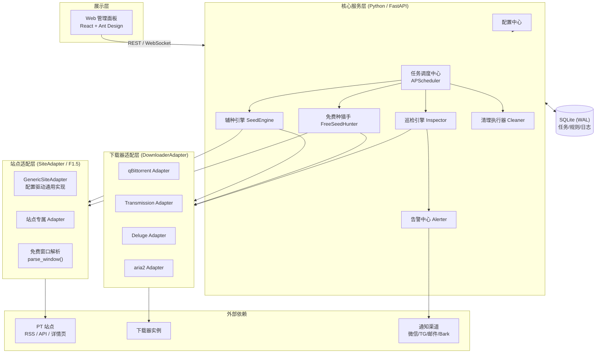
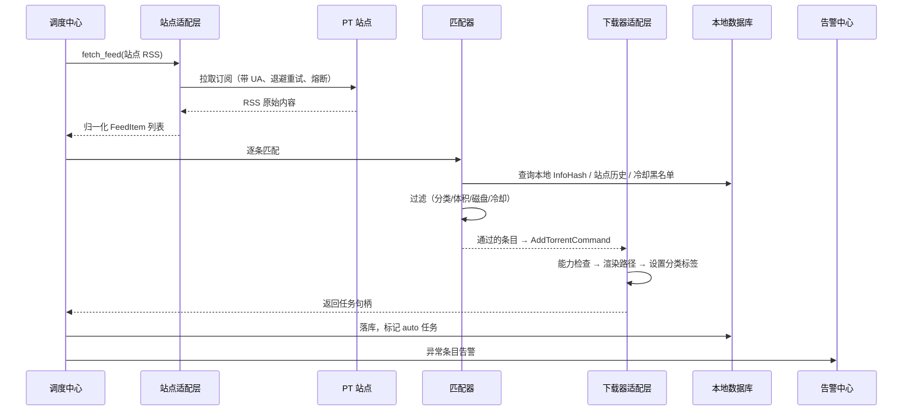
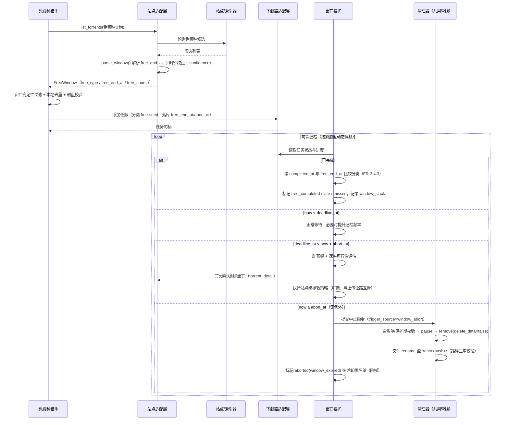

# PT 辅种与自动监测系统 · 项目需求文档

| 项目名称 | PT SeedHelper（暂定名） |
| :--- | :--- |
| 文档版本 | v1.2 |
| 文档状态 | 已评审通过 |
| 编写日期 | 2026-10-08 |
| 适用对象 | 产品、后端、前端、测试、运维 |
| 变更说明 | v1.1：超时看护逻辑由「固定时长」改为「**免费窗口锚定**」，新增 FR-3.0 窗口模型、FR-3.4 双阈值机制、FR-3.4.1 紧迫度分级、FR-3.4.2 提前完成检测、FR-3.8 抢救策略 |
| | v1.2（评审修订）：① `abort_at` 确立为**无例外绝对红线**，移除 `checking` 宽限与「人为干预豁免」；② 新增 **FR-6.4 免费种超期完成判定**（按 `completed_at` 而非 `now` 归属收益）；③ FR-3.5 中止流程**接入 FR-5.2 全部安全机制**（回收站 / 路径校验 / 二次确认），FR-4.1「种子文件错误」同样纳入；④ 删除 FR-3.0.1 与 FR-3.2 冲突的「窗口已过半仍抓取」分支，统一为**剩余不足即跳过**；⑤ 路径校验改为**下载器上报实际路径 + 实时 stat 校验**，不再依赖模板含 hash；⑥ 新增 **F1.5 PT 站点适配层**（一等公民，与下载器适配层并列）；⑦ 冷却黑名单增加 `reason` 与阶梯冷却；⑧ 补充 `ENCRYPTION_KEY`、SQLite WAL 与单写者队列约定；⑨ 修正拼写、编号乱序、指标计数、公式重复、分类迁移、FR-3.6/FR-3.8 职责重叠等一致性缺陷 |

---

## 1. 项目背景

### 1.1 现状问题

PT（Private Tracker）站的核心考核指标是**分享率（Share Ratio）**、**保种量**与**站点留存时间**。达标方式主要有两种：

- **做种（Seeding）**：手动挑选种子上传，效率低。
- **辅种（Cross-seeding）**：利用与已下载种子相同的 InfoHash，在其他用户尚未做种的站点上抢先做种，收益远高于做种。

当前 PT 用户面临的具体痛点：

| 编号 | 痛点 | 具体表现 |
| :--- | :--- | :--- |
| P1 | 辅种机会稍纵即逝 | 新种放出后几小时内无人做种，1~2 天后转种，此时辅种已无收益 |
| P2 | 手动检索效率极低 | 需逐站翻页搜索"未下载/未做种"列表，单次耗时 20~60 分钟 |
| P3 | 下载器能力割裂 | qBittorrent 有 RSS 自动下载，Transmission/Deluge 无，需为每个客户端单独折腾 |
| P4 | 免费种错过即亏 | 免费种（FreeLeech / 2X）窗口期极短，错过只能等下一批 |
| P5 | 清理靠肉眼 | 做种满时间、站点已删、错误种子的清理全靠人工翻列表，硬盘常年爆满 |
| P6 | 异常发现太晚 | 种子被站点删除、Tracker 报错、限速被改，往往数天后才发现，已造成 H&R 或删种违规 |

### 1.2 项目目标

构建一个**常驻式辅种与健康度监测服务**，实现：

1. **辅种自动化** — RSS 驱动的自动辅种，覆盖多站点、多下载器。
2. **免费种猎手** — 自动发现并抓取免费种，超时未完成自动中止，避免带宽与磁盘浪费。
3. **健康度监测** — 7×24 小时巡检种子状态、分享率、限速与连接数，异常即时告警。
4. **空间自动化** — 按规则自动清理已达保种标准的种子，安全可控地回收磁盘。

### 1.3 成功指标

| 指标 | 目标值 | 测量方式 |
| :--- | :--- | :--- |
| 辅种覆盖率 | 主流 PT 站 RSS 新种 15 分钟内完成辅种率 ≥ 90% | 站点"未做种"列表抽样比对 |
| 免费种捕获率 | 目标站点免费种抓取成功率 ≥ 80% | 抓取成功数 / 候选数 |
| 异常发现时延 | 种子异常平均发现时延 ≤ 30 分钟 | 告警记录时间戳 |
| 空间回收效果 | 闲置种子占用空间下降 ≥ 40% | 清理前后磁盘占用对比 |
| 资源占用 | 空闲时 CPU < 3%，内存 < 150MB（不干扰下载） | 容器监控 |

> ⚠️ 硬性红线：系统自身资源占用不得影响下载器做种质量，任何导致限速下降或 Tracker 异常的自身行为都视为严重缺陷。

---

## 2. 名词说明

| 术语 | 说明 |
| :--- | :--- |
| **PT 站** | Private Tracker 私有站点，需邀请注册，按分享率考核 |
| **InfoHash** | 种子文件唯一标识，辅种匹配的核心依据 |
| **辅种** | 在其他站点上添加与本地相同 InfoHash 的任务以获取上传量 |
| **做种 / Seeding** | 已下载完成、正在上传的任务状态 |
| **FreeLeech / 免费种** | 下载不计入流量或双倍计费的种子，做种收益高 |
| **2X / 中性种** | 下载量计为 2 倍或 0.5 倍的种子类型 |
| **免费窗口 (Free Window)** | 免费/减免权益的**有效时间段**。限时免费种通常有明确结束时刻，窗口关闭后做种收益大幅下降——这是本系统超时看护的锚点 |
| **限时免费 / 永久免费** | 限时免费有明确结束时间；永久免费无结束时间（常见于禁种/内部种），不做超时中止 |
| **窗口富余 (window_slack)** | 实际完成时刻与窗口结束时刻的差值，正值表示提前完成 |
| **分享率 (Ratio)** | 上传量 / 下载量，PT 站核心考核指标 |
| **Hit & Run (H&R)** | 未达站点要求即删除种子的违规行为 |
| **HR / 低分享率删除** | 分享率或保种时长不达标被站点强制删除 |
| **H&R 安全线** | 通常为分享率 1.0 或站点规定的最低值 |
| **RSS 自动下载** | 下载器订阅种子源后自动抓取并添加任务的机制 |
| **超时应中止** | 免费种在设定时限内未完成时主动终止，避免长期占用带宽与磁盘 |

---

## 3. 目标用户与使用场景

### 3.1 用户画像

- **主要用户**：拥有 20TB+ 存储、长期 7×24 运行下载器的 PT 重度用户
- **典型环境**：Docker 部署于 NAS / 家用服务器 / 小主机，旁挂 qBittorrent 或 Transmission
- **技术能力**：会写 docker-compose，能处理基础的端口与挂载问题，但不写代码

### 3.2 核心场景

**场景 A · 日常辅种（自动发生）**
系统每小时从各 PT 站 RSS 拉取新种 → 与本地 InfoHash 集合比对 → 命中未做种的直接添加到下载器 → 完成后自动转辅种池 → 达到保种时长的自动清理。用户全程无需干预。

**场景 B · 免费种抢收（时效性强）**
系统每 10 分钟轮询目标站点的免费种列表 → 解析每个种子的**免费窗口剩余时长** → 过滤类型/大小/重复项，并**跳过剩余窗口已不足的条目** → 立即添加并按该种子的窗口结束时刻设置看护 → 窗口关闭仍未完成则自动中止并清理 → 提前完成则锁定免费收益并转入常规辅种池。

> 举例：某站放出"剩余 2 天"的免费种，系统会持续抓取 2 天而非 45 分钟；某站"剩余 2 小时 45 分"，系统会在 2 小时 45 分后中止而非继续空耗带宽。

**场景 C · 健康巡检（异常发现）**
系统每 15 分钟巡检全部任务：种子被删、状态错误、做种数为 0、分享率跌破 H&R 安全线、连接数超限、限速被外部改动 → 推送告警到微信/Telegram/邮件。

**场景 D · 空间回收（批量操作）**
系统每日凌晨执行清理：站点已删的、错误种子的、做种满 N 天且已达分享率阈值的 → 进入回收站保留 7 天 → 自动彻底删除。

---

## 4. 需求范围

### 4.1 本期包含（In Scope）

- 多下载器适配：qBittorrent、Transmission、Deluge、aria2
- PT 站点适配层（RSS 拉取、免费窗口解析、站点状态核验，见 F1.5）
- PT 站点 RSS 订阅与自动辅种
- 免费种自动捕获与超时应中止
- 种子健康度与做种率监测 + 多渠道告警
- 自动删种与磁盘空间管理（含回收站与白名单保护）
- Web 管理面板（配置、状态查看、日志、手动操作）
- Docker 容器化部署

### 4.2 本期不包含（Out of Scope）

- 破解 / 绕过站点 Anti-Cheat 检测
- BT 客户端底层协议实现（不自己做种子嗅探）
- 站点自动注册 / 邀请码自动获取
- 无账号情况下的公开种子下载（仅限已登录 PT 站）
- 与第三方站点直接对接的账号买卖等灰色功能

---

## 5. 功能需求

### F1. 下载器多客户端适配层

**目标**：屏蔽各下载器 API 差异，上层业务只面向统一接口编程。后续新增客户端不改动业务代码。

**统一下载器能力接口（DownloaderAdapter）**

| 能力 | 方法签名 | 说明 |
| :--- | :--- | :--- |
| 连通性检测 | `ping() -> bool` | 校验地址、账号、密码可用 |
| 列出任务 | `list_torrents(filter) -> [TorrentInfo]` | 支持按状态、分类、标签过滤 |
| 添加种子 | `add_torrent(payload) -> TorrentHandle` | 支持 magnet / file / url |
| 删除任务 | `remove(hashes, delete_data) -> bool` | 支持保留数据删除 |
| 暂停/恢复 | `set_pause(hashes, paused) -> bool` | 批量操作 |
| 设置分类标签 | `set_category_tags(hashes, ...) -> bool` | 用于辅种隔离管理 |
| 设置保存路径 | `set_save_path(hashes, path) -> bool` | 配合分类做路径映射 |
| 设置限速 | `set_rate_limit(up, down) -> bool` | 全局与单任务限速 |
| 读取统计 | `get_stats() -> dict` | 全局上传/下载速率、连接数 |
| 获取日志 | `get_log(last_n) -> [str]` | 排障用 |
| 能力探测 | `capabilities() -> Set[Feature]` | 声明是否支持 RSS、标签、限速等 |

**各客户端能力矩阵**

| 能力 | qBittorrent | Transmission | Deluge | aria2 |
| :--- | :--- | :--- | :--- | :--- |
| 添加任务 | ✅ | ✅ | ✅ | ✅ |
| 分类 / 标签 | ✅ 类别+标签 | ⚠️ 仅 label | ⚠️ 需 Label 插件 | ❌ |
| 保存路径设置 | ✅ 逐任务 | ✅ 逐任务 | ✅ 逐任务 | ✅ |
| 逐任务限速 | ✅ | ❌ | ❌ | ❌ |
| 种子状态明细 | ✅ 最全 | ⚠️ 部分 | ✅ | ⚠️ 部分 |
| 原生 RSS | ✅ | ❌ | ❌ | ❌ |
| 逐任务文件清单（get_files） | ✅ | ⚠️ 部分 | ✅ | ⚠️ 部分 |


> **设计约束**：无原生 RSS 的客户端（Transmission/Deluge/aria2）由本系统自行拉取站点 RSS 后调 `add_torrent` 补齐能力，保证多端体验一致。分类/标签缺失的客户端以"路径隔离"作为降级方案。
>
> **超时应中止不属于客户端能力**：窗口锚定中止完全由本系统的看护引擎执行（FR-3.4），任何客户端 API 都不提供"超时应中止"功能，故不纳入能力矩阵。
>
> **逐任务文件清单是数据安全的硬依赖**：FR-5.2.5a 与 FR-3.5.1 要求删除目标必须取自下载器上报的文件清单。若某客户端只能返回部分文件清单或仅能返回顶层 `save_path`，则该客户端**禁止启用任何数据删除能力**（含免费种中止），只能"移除任务 + 保留数据"，并在面板显式提示降级原因。

**FR-1.1** 系统必须支持同时连接 ≥ 3 个下载器实例，各实例独立配置、独立开关。

**FR-1.2** 单个下载器连接失败不得阻塞其他下载器与主流程，失败进入重试队列并告警。

**FR-1.3** 新增下载器适配器需实现上述接口的**全部**方法，不允许抛 `NotImplementedError` 上抛业务层；确不支持的能力通过 `capabilities()` 声明并由业务层降级。

---

### FR-1.5 PT 站点适配层（Site Adapter）

**目标**：与下载器适配层对称，把「站点差异」全部收拢在一层。辅种引擎与免费种猎手只面向统一站点接口编程，新增/修复站点不改动引擎代码（对应风险 R1、R9）。

**统一站点能力接口（SiteAdapter）**

| 能力 | 方法签名 | 说明 |
| :--- | :--- | :--- |
| 连通性检测 | `ping() -> SiteHealth` | 校验域名可达、Cookie/登录态有效 |
| 拉取 RSS | `fetch_feed(url) -> [FeedItem]` | 返回归一化的种子条目（见 FR-1.5.1） |
| 搜索/列表 | `list_torrents(query) -> [TorrentBrief]` | 免费种候选来源（P0，见 FR-3.1） |
| 种子详情 | `torrent_detail(id) -> TorrentBrief` | 取 `free_until` 等权威字段（来源优先级 1） |
| **解析免费窗口** | `parse_window(detail) -> FreeWindow` | **核心扩展点**，返回 `free_type` + `free_end_at` + `free_source` |
| 站点时钟 | `site_clock() -> datetime` | 用于 FR-3.0.2 `clock_offset` 探测 |
| 种子状态核验 | `verify_status(info_hash) -> enum` | 站点是否已删种 / 是否违规（FR-4.1「种子被站点删除」） |
| 能力探测 | `capabilities() -> Set[SiteFeature]` | 声明是否支持搜索 API、详情 API、RSS、时间戳字段等 |

**FR-1.5.1 通用站点适配器（GenericSiteAdapter）**
多数 PT 站点共用同一套技术栈（自研 PHP + 相似 URL 结构），因此提供**配置驱动的通用实现**，通过站点配置表（`sites` 表字段）覆盖差异，避免为每个站点写一个类。站点专有能力（如特殊优惠语义）再以子类覆盖。

**FR-1.5.2 站点差异配置化（替代"硬编码解析"）**

站点文案与字段的多样性通过配置驱动，而非散落在代码中：

| 配置项 | 作用 | 对应原 `time_unit_multiplier` |
| :--- | :--- | :--- |
| `rss_time_pattern` | "剩余 X 天 Y 小时" 文案正则（含中文/英文/繁中变体） | — |
| `window_field_map` | 详情页/JSON 中免费结束字段名（`free_until` / `promotion_end` / `expires_at`…） | — |
| `free_type_map` | 站点优惠标记 → 统一 `free_type` 枚举的映射 | — |
| `download_factor_map` | 下载因子（0/0.5/1/2）→ `free_type` 的推导规则 | — |
| `detail_path_template` | 详情页 URL 模板（`{id}` / `{hash}`） | — |
| `time_unit_multiplier` | 时间单位倍数（部分站点以"分钟/小时"计） | 保留 |

**FR-1.5.3 免费窗口解析契约**

`parse_window()` 的返回值是 FR-3.0 全部窗口来源的唯一入口，必须满足：

```
FreeWindow = {
  free_type: freeleech_timed | freeleech_permanent | twoup_timed | neutral_leech | unknown,
  free_end_at: datetime | None,   # None 表示永久免费或无法判定
  free_source: api | list_text | rss_desc | site_default | learned,   # 对应 FR-3.0 来源 1~5
  raw_text: str,                   # 原文，供面板追溯与解析失败告警
  confidence: float                # 0~1；<0.6 时引擎按 unknown 保守处理并 🟡 告警
}
```

- **不得**在适配器内直接决定是否中止——适配器只负责「如实解析窗口」，**判定与中止由 FreeSeedHunter 统一执行**（避免站点逻辑渗入业务层）。
- `confidence` 低或 `free_end_at` 为 `None` 且 `free_type != freeleech_permanent` 时，引擎降级到 FR-3.0 来源 4/5 兜底并告警。
- `freeleech_permanent` 的判定优先级**最高**：一旦识别为永久免费，`free_end_at=None` 且不参与任何超时中止（FR-3.0 表、R10），可视为"解析失败"的红线情形需 🟡 告警。
- 解析逻辑必须有**独立单元测试**：以附录 D 场景为用例集，含繁中/英文文案、跨月/跨年、时间单位换算、时钟偏差。

**FR-1.5.4 站点健康与降级**
- 单站点解析持续失败 → 该站熔断（复用 FR-2.2 熔断机制），告警但**不影响其他站点**（FR-1.2 精神）。
- 站点被判定"改版"（连续 N 次解析 `confidence` 全低）→ 🔴 告警，提示该站 `SiteAdapter` 需更新。

---

### F2. PT 站点对接与自动辅种

**FR-2.1 站点管理**
支持维护站点列表，每站配置：站点名、站点域名、RSS 订阅地址（个人 RSS，含 passkey）、WebUI/API 地址、账号密码、所属下载器、启用开关、辅种分类名、保存路径模板、上传/下载限速。

**FR-2.2 RSS 拉取**
- 支持多种 RSS 源形态：站点原生个人 RSS、站点搜索结果 RSS、Jackett/Torznab 索引器订阅
- 拉取频率可配置（默认 60 分钟，PT 站对高频请求敏感，**下限强制 15 分钟**）
- 请求必须携带站点 UA，带指数退避重试（3 次），429/403 立即熔断该站 1 小时
- 拉取结果写入本地 SQLite 并记录每次拉取的条目数、耗时、结果状态

**FR-2.3 辅种匹配（核心逻辑）**
对每条 RSS 条目，依次判定：

| 判定项 | 规则 | 不通过处理 |
| :--- | :--- | :--- |
| 已有同 InfoHash | 本地任一下载器中存在该 hash 且未删除 | 跳过 |
| 站点去重 | 本地记录中该站曾添加过该 hash | 跳过（`history` 表） |
| 分类匹配 | 站点配置了"只辅种分类"，条目不在白名单则跳过 | 跳过 |
| 体积上限 | 条目大小 > 站点配置的 `max_size` | 跳过 |
| 冷却期 | 该 hash 在冷却黑名单中（用户主动移除过） | 跳过 |
| 磁盘空间 | 目标分区可用空间 < 条目大小 × 1.1 | 跳过并记录 |
| 路径模板渲染 | 无法生成合法保存路径 | 跳过并告警 |

全部通过 → 生成 `AddTorrentCommand` 投递到目标下载器。

**FR-2.3.1 冷却黑名单的分类与阶梯**

不同原因导致的"跳过"语义完全不同，必须区分记录，否则系统会把用户的主动决策误当作系统故障，也无从做阶梯冷却：

| `reason` | 触发方 | 冷却时长策略 | 说明 |
| :--- | :--- | :--- | :--- |
| `user_removed` | 用户在面板手动移除 | **长期**（默认 30 天，可手动解除） | 用户明确表示不要，禁止系统自动重试 |
| `user_blacklisted` | 用户手动拉黑 | **永久**，需手动解除 | 人工决策优先级最高 |
| `window_expired` | 免费种窗口红线中止（FR-3.5） | 阶梯：1 次 24h → 2 次 72h → 3 次 7 天 → ≥4 次 30 天 | 窗口不足导致的失败，与"种本身有问题"无关 |
| `dead_torrent` | Tracker 失效 / 站点已删（FR-4.1） | 阶梯：1 次 7 天 → 2 次 30 天 → ≥3 次 永久 | 很可能站点已删种，重试无意义 |
| `disk_full` | 磁盘空间不足跳过 | **不入冷却** | 空间恢复后应立即可辅种，否则错过收益 |
| `duplicate` | 同站重复添加 | 不入冷却，仅记 `history` | 幂等由 `history` 表保证，非冷却职责 |
| `manual_skip` | 规则/过滤条件跳过 | 不入冷却 | 下轮重新判定 |

- `cooldown_hash` 表须含 `reason`、`fail_count`、`cooldown_until`、`last_at` 字段；`fail_count` 按 `reason` 独立计数（不同原因不共享阶梯）。
- **仅 `reason ∈ {user_removed, user_blacklisted}` 的条目禁止系统自动解除**；其余到期自动失效。
- 同一 hash 在不同站点冷却**相互独立**（辅种收益按站点计算）。

**FR-2.4 任务隔离**
辅种任务统一使用独立分类（如 `cross-seed`）与独立标签（如 `auto`, `site:<站点名>`），与用户手动任务物理隔离，保证自动清理不会误伤手动任务。

**FR-2.5 做种数异常处置**
对标记为辅种的任务，若监控到连续 2 个巡检周期 `做种数 == 0` 且上传速率为 0：
1. 判定为"空做种"，不产生任何收益
2. 自动降级为暂停状态并记录日志
3. 累计超过 `empty_seeding_tolerance`（默认 24 小时）→ 移入清理候选

**FR-2.6 操作审计**
所有对下载器的写操作（添加/删除/暂停/改路径/改限速）必须记录：时间、下载器实例、操作类型、涉及 hash 数量、原因触发源（定时任务/手动/告警联动）、执行结果。支持在面板检索与导出。

---

### F3. 免费种自动捕获与超时应中止

这是本项目的时效性核心模块。核心设计原则：**中止时机锚定"免费窗口"的结束时刻，而非固定时长**。免费窗口是收益窗口，一旦窗口关闭仍未完成，继续占用带宽与磁盘就是纯负收益，必须立即中止。

**FR-3.0 免费窗口模型（核心前提）**

系统将"免费/减免"的收益窗口抽象为统一模型，每种优惠类型有明确的窗口语义：

| 优惠类型 | 窗口语义 | 窗口结束后的收益 |
| :--- | :--- | :--- |
| `freeleech_timed` 限时免费 | 站点声明的明确结束时间 | 下载量正常计入，**新增做种收益归零** |
| `freeleech_permanent` 永久免费 | 无结束时间 | 不适用（不做超时中止，仅按常规辅种处理） |
| `twoup_timed` 限时 2X | 明确结束时间 | 降为 1X |
| `neutral_leech` 中性种 | 通常无结束时间 | 不适用 |
| `unknown` 类型未知 | 无法判定 | 按限时免费保守处理 |

窗口结束时刻 `free_end_at` 的来源优先级：

| 优先级 | 来源 | 说明 |
| :--- | :--- | :--- |
| 1 | 站点种子详情页/API 明确返回 | 最准确，如 `free_until`、`promotion_end`、`expires_at` |
| 2 | 站点列表页的"剩余 X 小时/X 天"文案 | 需解析为绝对时间，**必须做时钟偏差校正**（见 FR-3.0.2） |
| 3 | RSS 条目描述中的结束时间信息 | 精度较低，需容错解析 |
| 4 | 用户按站点/分类配置的默认窗口 | 均值兜底，如该站免费种通常为 72 小时 |
| 5 | 按历史成功任务反推的自学习估算 | 依据该站同类种子的实际完成时长分布，取分位数 |

**FR-3.0.1 截止时间计算**

```
free_end_at  = 窗口结束时刻（见上表来源优先级）
safety_gap   = 安全余量 = max(窗口时长 × buffer_ratio, min_buffer)
              默认 buffer_ratio = 0.10, min_buffer = 30 分钟
deadline_at  = free_end_at - safety_gap
abort_at     = free_end_at            # 硬性红线，deadline_at 仍未完成则在此强制中止
```

**设计要点**：
- **双阈值机制**：`deadline_at` 是预警线（触发 🟡 告警，可选自动提速或暂停让路）；`abort_at` 是硬性红线（必定执行中止）。二者分离避免误杀。
- **不设上限兜底**：若站点声明的免费窗口极长（如 30 天），系统**不**主动压缩——此时唯一的中止理由是磁盘不足、Tracker 失效或用户手动取消。这保证"长窗口免费种"能被完整拿下。
- **窗口过短即跳过**：若 `free_end_at - now < min_buffer × 3`（默认 90 分钟），判定为"窗口剩余不足，即使立刻开下也大概率补不完"，**在候选阶段直接跳过，不创建任务**。此判定在候选过滤阶段（FR-3.2）执行并告警一次；**不存在**"跳过常规候选但仍抓取并高优先级看护"的分支——两者语义互斥，避免同一条件产生相反动作。
- **跳过阈值的例外**：仅当条目体积极小（预计 30 分钟内可完成）或用户显式开启 `grab_short_window` 时才允许抓取，此时 `safety_gap` 按实际预估完成时长计算而非固定比例。

**FR-3.0.2 站点时钟偏差校正**
PT 站服务器时间可能与本机存在偏差，且列表页"剩余 X 小时"为相对值，转换时误差会被放大。系统必须：
1. 在每个站点首次访问时记录"站点响应时间 - 本地时间"作为偏移量 `clock_offset`
2. 站点级可手动校正（如站点页面显示与本机相差 5 分钟）
3. `free_end_at = 本地时间 + 站点声明的剩余时长 - clock_offset`
4. 当 `abort_at` 距今不足 `min_buffer` 时，**主动向站点二次确认剩余时长**（以站点为准，不信任本地推算），确认后修正

**FR-3.1 候选来源**

| 来源 | 说明 | 优先级 |
| :--- | :--- | :--- |
| 站点搜索 API | 站点提供的 REST API，按 `freeleech=true&order=desc` 等参数查询 | P0 |
| 站点 RSS 过滤 | 对已有 RSS 源按标题/描述关键字过滤免费种 | P0 |
| 索引器 | Jackett 输出的 Torznab 结果，按 `download_factor=0` 过滤 | P1 |
| 手工订阅列表 | 用户手动维护的种子详情页链接列表 | P1 |

**FR-3.2 过滤规则**（站点级可配）

- 类型：仅 FreeLeech；可选包含 2X / 中性种（**窗口语义按 FR-3.0 表执行**）
- 大小区间：如 `[1GB, 60GB]`
- 分类白名单/黑名单
- 排除本地已存在（InfoHash 比对 + 文件名+大小模糊比对）
- 排除已失败记录（同一 hash 连续失败 N 次后进入冷却，默认冷却 24 小时）
- 排除近期被自动清理过的 hash
- **排除剩余窗口不足者**：解析出 `free_end_at` 且 `free_end_at - now < min_buffer × 3` 的条目直接跳过（补不完了，放弃）

**FR-3.2.1 窗口时长自适应**
实践中不同站点/分类的免费窗口差异巨大（数小时 → 数周），因此 `timeout_minutes` **不作为主配置项**。站点级可配的是：
- `default_free_duration`（该站默认窗口，如 72 小时）
- `min_buffer` / `buffer_ratio`（安全余量）
- 允许站点级 `max_duration_cap`（可选硬上限，仅作兜底，默认不启用）

`timeout_minutes` 仅作为**全部来源均无法解析窗口时长**时的最终兜底值（默认 720 分钟 = 12 小时），并在使用时产生 🟡 告警提示"窗口时长未知，已按兜底值处理"。

**FR-3.3 抓取与添加**
- 轮询间隔默认 10 分钟（站点级可调，下限 3 分钟）
- 命中候选后立即添加：magnet 或种子文件，分类 `free-seed`，路径按模板 `{站点}/{分类}/{种子名}` 渲染
- 落盘后**必须做 Tracker 健康校验**：调用 Tracker announce 或检查添加后 3 分钟内状态是否变为 `checking → downloading`，校验失败则判定为死种并立即中止
- **窗口信息落库**：添加成功后将 `free_type`、`free_end_at`、`free_duration`、`free_source`（窗口来源，枚举见 FR-3.0）、`clock_offset` 一并写入任务记录，作为后续看护的唯一依据

**FR-3.4 超时看护：以免费窗口为锚点（重点）**

**核心语义**：看护的终止条件是"**免费窗口已关闭**"，而非"下载耗时超过 N 分钟"。免费窗口是收益窗口——窗口关闭后继续下载，产出的数据只能获得普通做种收益（甚至超期被站点删种），而带宽与磁盘成本照付。

截止时间字段在任务创建时一次算清并持久化（公式定义见 FR-3.0.1，此处不重复）：

```
free_end_at  = 免费窗口结束时刻（来源见 FR-3.0，优先级 1→5）
safety_gap   = max(free_duration × buffer_ratio, min_buffer)
deadline_at  = free_end_at - safety_gap     # 预警线
abort_at     = free_end_at                  # 硬性红线（无例外）
```


> **不设固定时长上限**：若站点声明窗口为 30 天，系统不会压缩它——唯一的中止理由只剩磁盘不足、Tracker 失效、用户手动取消。这保证长窗口免费种能被完整拿下。`timeout_minutes` 降级为"无法解析窗口时的最终兜底"，不再是主逻辑。
>
> **`abort_at` 为无例外绝对红线**：一旦 `now ≥ abort_at` 且任务未完成，无论处于何种状态（`downloading` / `stalledDL` / `pausedDL` / `checking` / 用户曾手动暂停），系统**必定且立即**执行中止流程，不存在任何宽限期或豁免条件。理由：窗口关闭后继续下载的数据只能获得普通做种收益，带宽与磁盘成本照付；且站点通常在窗口关闭后仍继续扣分享率，超期下载是纯负收益。若用户确需保留该任务，只能由用户**手动**介入并自行承担后果，系统不提供自动豁免。
>
> **截止时间字段在任务创建时一次算清并持久化**（公式定义见 FR-3.0.1，此处不重复定义）：`free_end_at` / `deadline_at` / `abort_at` 三者落库后不再随巡检变化，仅因 `SiteAdapter` 二次确认窗口时可修正一次（FR-3.0.2 第 4 条）。

巡检逻辑（每次巡检执行）：

| 任务状态 | 剩余时间 | 动作 |
| :--- | :--- | :--- |
| `downloading` / `stalledDL` | `now < deadline_at` | 继续等待，记录进度与速率预测 |
| `downloading` / `stalledDL` | `deadline_at ≤ now < abort_at` | 🟡 预警：告警 + 按当前速率评估"能否在窗口内完成"；若不能则建议提速/让路；同时向站点**二次确认剩余窗口** |
| `downloading` / `stalledDL` | **`now ≥ abort_at`** | 🔴 **执行中止流程**（原因 `window_expired`） |
| `pausedDL` | `now < deadline_at` | 尝试自动恢复一次；仍暂停则标记 `paused_by_user`（仅用于面板标注与统计），**看护逻辑与普通任务完全一致，不产生任何豁免** |
| `pausedDL` | `now ≥ abort_at` | 🔴 执行中止流程（原因 `paused`，即"到红线时仍未完成"） |
| `checking` | `now < abort_at` | 正常等待，检查结束转 `downloading` 或 `error` |
| `checking` | **`now ≥ abort_at`** | 🔴 **执行中止流程**（原因 `window_expired`）。为避免在文件校验中途强删造成下载器状态错乱，先调用 `remove(delete_data=false)` 移除任务，再由回收站流程处理数据（见 FR-3.5） |
| `seeding` / `uploading` | 任意 | 已成功 → 按 **FR-6.4** 判定收益归属 |
| `error` / `missingFiles` | 任意 | 不等窗口，立即进入中止流程（原因 `error`） |
| 任意（未完成） | `now ≥ abort_at` | 🔴 **兜底行**：上表未覆盖的任意状态一律执行中止流程（原因 `window_expired`） |

> **设计说明**：巡检表最后一行是兜底条款。任何新增的下载器状态都默认"到红线即中止"，避免因状态枚举不全导致任务超期滞留。

**FR-3.4.1 剩余时间紧迫度分级**
按 `remaining = free_end_at - now` 分级，驱动面板配色、巡检频率与告警级别：

| 剩余时间 | 级别 | 面板标识 | 行为 |
| :--- | :--- | :--- | :--- |
| > 24h | 正常 | 绿色 | 无干预 |
| 6h ~ 24h | 注意 | 蓝色 | 巡检频率提升至 5 分钟 |
| 1h ~ 6h | 临近 | 橙色 | 🟡 一次告警 + 速率可行性评估 |
| 30min ~ 1h | 紧急 | 深橙 | 🟡 告警 + 建议手动提速 |
| < 30min | 临界 | 红色 | 巡检频率提升至 1 分钟；已过 `deadline_at` 未完成 → 提醒"窗口即将关闭，建议立即中止" |

**FR-3.4.2 提前完成检测与收益锁定**
- 进度达 100% 时立即标记 `free_completed`，记录 `free_duration = completed_at - added_at`，作为 FR-3.0 来源 5 的自学习样本
- 完成后**不执行**中止判定，转入常规辅种池，由 F5 清理规则按分享率与保种时长接管
- 记录 `window_slack = free_end_at - completed_at`（实际富余时间），用于评估该站窗口配置是否合理

**FR-3.4.3 超期完成的收益归属（消除歧义）**

"完成"与"在窗口内完成"是两件事。巡检时任务可能已是 `seeding`，但 `completed_at` 早于或晚于 `free_end_at`，收益归属完全不同：

| 判定条件 | 分类 | 是否计入 FR-3.7 免费种成功统计 | `window_slack` | 说明 |
| :--- | :--- | :--- | :--- | :--- |
| `completed_at ≤ free_end_at` | `free_completed` | ✅ 计入 | `free_end_at - completed_at` ≥ 0 | 真正吃到优惠，纳入自学习样本 |
| `completed_at > free_end_at` 且 `completed_at ≤ abort_at` | `free_completed_late` | ⚠️ **单独计数，不计入成功率分子** | 负值 | 在红线前完成，数据完整，但站点很可能已按普通计费结算 |
| `completed_at > abort_at` | `free_missed` | ❌ **不计入成功** | 负值 | 超期完成，视为"看护失效"，必须触发 🔴 自检告警 |

**判定基准是 `completed_at`（下载器上报的完成时刻），不是巡检时刻 `now`。** 因此：

- 若任务在 `now ≥ abort_at` 的**这次**巡检中被发现已完成，**不执行中止**，转而按上表回溯分类。
- 边界容差：`completed_at` 的判定允许 `check_interval_tolerance`（默认 120 秒）误差——巡检存在滞后，完成时刻可能落在上一次采样之前。
- `free_missed` 的根因必须回溯记录（任务何时未被巡检到、是否因 `paused_by_user`、是否因 `error` 提前终止），并计入 FR-3.7 的失败归因分布，作为看护链路可靠性的度量。
- FR-3.7 需**新增三个指标**：窗口内完成数、边界超期完成数（`free_completed_late`）、看护失效数（`free_missed`），并给出"窗口内完成率 = free_completed / (free_completed + free_completed_late + free_missed + aborted)"。
**FR-3.5 中止流程（Abort Pipeline）**

> **设计原则**：中止是**任务移除 + 数据隔离**，不是数据删除。免费种中止与 F5 清理**共用同一条执行管线（Cleaner）**，继承 FR-5.2 的全部六重安全机制。不存在"免费种专用的直删通道"。
>
> 与 F5 清理的唯一区别是**触发源不同**：F5 由用户规则/定时任务触发，FR-3.4 由窗口红线触发。两者在审计日志中通过 `trigger_source` 区分（`window_abort` / `rule` / `manual` / `alert_linked`）。

严格按顺序执行，任一步失败记录并继续：

| 步 | 动作 | 失败处理 |
| :--- | :--- | :--- |
| 1 | **前置安全校验**（继承 FR-5.2.1/5/6）：目标任务命中白名单（分类/标签/手动收藏）→ 跳过中止并 🔴 告警；仍在 `protect_hours` 保护期内 → 推迟到保护期结束再执行并记录；校验下载器上报的实际保存路径 | 校验失败 → **中止整个流程**，不删数据，仅告警 |
| 2 | 暂停任务（`set_pause`） | 记录后继续 |
| 3 | 从下载器移除任务，**`delete_data=false`** | 失败则重试 3 次；仍失败 → 停止后续数据操作，转 🔴 告警（任务残留但数据安全） |
| 4 | **数据隔离**（非删除）：将本次任务对应的文件/目录 `rename` 移入 `.seedhelper/trash/<info_hash>/`，保留 `trash_meta.json`（含原始路径、所属任务、过期时间） | 移入失败 → 停止，记录待清理项，**绝不退化为直接删除** |
| 5 | 写回本地记录：`status=aborted`、`aborted_reason=window_expired`（或其他 FR-3.4 表中标明的原因）、`aborted_at`、`window_slack=NULL` | — |
| 6 | 该 InfoHash 按 `reason=window_expired` 加入冷却黑名单（默认 24h，见 FR-2.3.1） | — |
| 7 | 释放并发槽位（FR-3.6） | — |
| 8 | 记录审计日志与统计（继承 FR-5.2.7） | — |

**FR-3.5.1 数据隔离的精确性要求**

- 隔离目标**必须**来自下载器实时上报的文件清单（`get_files()`），不得依赖路径模板字符串拼接或通配符匹配。
- 删除/移动前必须 `stat()` 校验目标真实存在且 `st_dev` 位于配置的下载根目录之下，防路径穿越与符号链接逃逸（继承 FR-5.2.5）。
- **禁止** `rm -rf` 目录；**禁止**删除非本任务路径下的任何文件；单任务超出路径根目录立即 🔴 告警并跳过。
- 中止产生的回收站条目遵循 `trash_retention_days`（默认 7 天）后由清理任务彻底删除；用户在保留期内可在面板"清理中心"一键恢复。

**FR-3.5.2 与二次确认的关系**

窗口红线中止是**系统自动行为，默认不阻塞在确认队列**（否则超时任务会持续占用带宽，与中止初衷相悖）。但仍受以下约束：
- 单次中止若涉及 **任务数 > `batch_limit`（默认 20）** 或 **释放空间 > `space_limit`（默认 200GB）**，仍转入人工确认队列（继承 FR-5.2.4）——异常风暴场景需人工介入确认。
- `abort_at` 红线判定本身**不受静默时段、告警去重、风暴保护影响**，始终执行。
- 中止**前 30 分钟**（`abort_at - 30min` 起）已由 FR-3.4 发出 🔴 预告告警，给用户手动保留的机会。

**FR-3.6 并发与带宽保护（上传让路的唯一责任方）**
- 同一站点同时进行的免费种任务数上限（默认 2），防止瞬时拉满带宽
- 免费种任务独立限速（可配，如单任务下载限速 20MB/s）
- 当系统检测到主任务上传速率 > 阈值的 80% 时，**自动暂停免费种下载**优先保障上传（做种优先原则）

> **职责边界**：FR-3.6 负责「上传占满 → 让路」，FR-3.8 负责「窗口告急 → 抢救」。二者互斥且顺序固定：
>
> | 条件 | 生效方 | 行为 |
> | :--- | :--- | :--- |
> | 上传速率 > `yield_to_seeding_threshold`（上传优先） | **FR-3.6** | 立即暂停所有免费种下载 |
> | 上传回落到阈值 × 0.7 以下并持续 `yield_recover_minutes`（默认 10 分钟） | **FR-3.6** | **自动恢复**被让路的免费种任务（唯一自动恢复路径） |
> | 进入 `deadline_at` 区间且预计无法完成 | **FR-3.8** | 执行站点级抢救策略 |
> | 两者同时成立 | **上传优先** | FR-3.6 生效；FR-3.8 只能告警，不得在让路期间提速（提速会挤占上传带宽） |
>
> 让路暂停与「人为暂停」（FR-3.4 `paused_by_user`）须用**不同标记字段**区分（`paused_reason ∈ {yield, user, system}`），避免让路被误判为人工干预。

**FR-3.7 结果可视化**

免费种模块需在面板提供：

| 指标组 | 内容 |
| :--- | :--- |
| 今日 | 捕获数、成功数、中止数（含原因分布：窗口过期/错误/人为/磁盘/Tracker 失效） |
| 累计 | 捕获总量与总下载量、平均完成耗时 |
| 窗口质量 | 平均窗口富余时间（`window_slack`）、窗口时长解析成功率（按 `free_source` 分布） |
| **收益归属**（FR-3.4.3） | 窗口内完成数 / 边界超期完成数（`free_completed_late`）/ 看护失效数（`free_missed`）/ 窗口内完成率 |
**FR-3.8 窗口到期前的"抢救"策略（可选，默认关闭）**

> 与 FR-3.6 互斥，见该节职责边界表。上传让路生效期间本节策略降级为 `notify_only`。

对于进入 `deadline_at` 预警区间但预计无法完成的免费种，系统可选择执行抢救而非直接放弃：

| 策略 | 动作 | 适用场景 |
| :--- | :--- | :--- |
| `speed_up` 临时提速 | 临时上调该任务下载限速（不超过全局下载上限） | 上传带宽空闲、窗口剩余时间充裕 |
| `yield_then_retry` 让路后重试 | 暂停让路给做种，窗口剩余仍 > 50% 时择机恢复 | 上传占满带宽 |
| `notify_only` 仅告警 | 只推送提醒，人工决定 | 默认策略，最安全 |
| `abort_now` 立即中止 | 提前放弃 | 判定为补不完时立即止损（走 FR-3.5 管线，数据入回收站） |

策略选择需在站点级配置，默认 `notify_only`。**任何策略都不得突破 `abort_at` 硬性红线**——所有抢救动作必须在 `now < abort_at` 时生效，`abort_at` 一到立即无条件执行 FR-3.4 中止流程。

**FR-3.9 免费种完成后的辅种池归属**

免费种完成后不新建任务，而是**原地转正**，避免重复辅种：

| 项 | 处理 |
| :--- | :--- |
| 分类 | 由 `free-seed` **迁移为** `cross-seed`（保留 `free-seed` 标签以追溯来源） |
| `source` 字段 | 由 `free_seed` **改为** `auto_seed`（转正后其行为等同普通自动辅种） |
| 路径 | **保持不变**（不做迁移，避免大规模文件移动；分类与路径解耦） |
| 标签 | 保留 `free`、`site:<name>`、`free_completed` 等来源标签，供审计与统计 |
| 后续接管 | 由 F5 清理规则按分享率与保种时长接管（FR-3.4.2） |

> **设计理由**：`source` 决定 F5.1 清理规则的「触发源」维度（仅自动辅种 / 仅免费种 / 全部），若转正后 `source` 仍为 `free_seed`，则该任务永远不会被"仅自动辅种"规则命中，清理语义出错。分类与 `source` 必须同步迁移，这是 FR-3.4.2「转入常规辅种池」的落地定义。

---

### F4. 健康度与做种率监测

**FR-4.1 巡检对象与指标**（默认 15 分钟一轮）

| 指标 | 判定逻辑 | 级别 | 建议动作 |
| :--- | :--- | :--- | :--- |
| 种子被站点删除 | Tracker 返回 404/站点 API 标记已删（`SiteAdapter.verify_status`） | 🔴 严重 | 告警 + 移入清理候选（**走 FR-5.2 全部机制**） |
| 种子文件错误 | 状态 `error` / `missingFiles` | 🔴 严重 | 告警 + 移入清理候选（**走 FR-5.2 全部机制**，见 FR-4.1.1） |
| 非法种子 | 状态 `checking` 长期失败 / `unknown` | 🟡 警告 | 告警，人工确认（**不自动删除**） |
| 做种数 = 0 | `num_seeds == 0` 且上传为 0 持续 2 轮 | 🟡 警告 | 自动暂停（见 FR-2.5） |
| 分享率跌破安全线 | `ratio < 1.0`（可配）且站点已过 H&R 期限 | 🟡 警告 | 告警 + 建议补种 |
| 保种时长不足 | 站点剩余时间 < 阈值 且 ratio 不足 | 🔴 严重 | 强提醒 |
| 下载速度为零 | `dlspeed == 0` 持续 30 分钟且非暂停 | 🟡 警告 | 尝试重启任务 |
| 连接数超限 | `num_connections > 用户阈值`（默认 500） | 🟡 警告 | 告警，提示检查 |
| 限速被改动 | 全局限速值 ≠ 期望值 | 🟡 警告 | 告警 + 可选自动纠正 |
| 端口不可达 | 监听端口探测失败 | 🔴 严重 | 告警（会导致 0 种） |
| 磁盘空间不足 | 可用空间 < 阈值（默认 50GB） | 🔴 严重 | 告警 + 触发清理 |
| 客户端异常 | WebUI 无响应 / 账号失效 | 🔴 严重 | 告警 + 熔断重试 |

> 上表共 **12** 项健康指标（对应 M3 里程碑口径）。

**FR-4.1.1 异常自动处置的安全边界**

巡检触发的自动动作分为两级，**不得混淆**：

| 级别 | 动作 | 是否触碰数据 | 安全要求 |
| :--- | :--- | :--- | :--- |
| **无数据副作用** | 告警、暂停、重启任务、空做种降级 | ❌ | 可全自动执行（FR-2.5 自动暂停除外需过保护期） |
| **移除任务 / 隔离数据** | 从下载器移除任务、移入回收站 | ✅ | **必须走 FR-5.2 全部机制**（白名单 / 回收站 / 路径三重校验 / 二次确认 / 审计），`trigger_source=alert_linked` |

- 原「种子文件错误 → 自动删除任务」更正为「**移入清理候选**」：即进入 F5 清理管线的候选集，仍需命中用户启用的清理规则才会执行；若用户未配置对应规则，则仅告警保留任务。
- 禁删保护期（`protect_hours`）对告警联动处置同样生效：刚添加即报 `error` 的任务推迟处理，避免下载器瞬时状态抖动导致误删。
- 若因下载器 `error` 状态而中止免费种任务，`aborted_reason=error`（优先于 `window_expired`），并按 FR-2.3.1 以 `dead_torrent` 原因进冷却。

**FR-4.2 告警渠道**
支持多渠道并行，均可单独开关：微信（企业微信/Server 酱）、Telegram Bot、邮件（SMTP）、Bark 推送、Webhook（自定义）、面板内通知中心。

**FR-4.3 告警策略**
- **去重与聚合**：同一 hash + 同一告警类型在 `mute_window`（默认 6 小时）内不重复推送
- **分级静默**：🟡 警告每日汇总一次；🔴 严重立即推送
- **风暴保护**：单日告警超过 50 条时自动降级为汇总推送
- **静默时段**：可配置免打扰时段（如 02:00–07:00），但 🔴 严重级别不受静默限制

---

### F5. 自动删种与空间管理

**FR-5.1 清理规则引擎**
用户可配置多条规则，按优先级依次执行，命中即停（避免规则冲突）。规则维度：

| 维度 | 可选条件 |
| :--- | :--- |
| 触发源 | 仅自动辅种任务 / 仅免费种任务 / 全部（默认**不含手动任务**） |
| 站点 | 按站点分组应用不同保种天数 |
| 状态 | 站点已删、错误、暂停、空做种 |
| 做种时长 | ≥ N 天 |
| 分享率 | ≥ N（通常 2.0~5.0） |
| 大小 | ≥ N GB（大文件优先释放空间） |
| 分类 / 标签 | 按分类批量清理 |
| 空间压力 | 磁盘可用 < 阈值时，清理优先级自动升为最高 |

**FR-5.2 安全机制（强制要求，不可关闭）**

> **适用范围**：本节机制对**所有**删除/移除数据的路径生效，包括 F5 规则清理、F3 免费种窗口中止（FR-3.5）、F4 异常自动处置。**任何模块不得实现绕过本节的直删通道。**

**FR-5.2.1 白名单保护**：指定分类 / 标签 / 手动收藏的任务永不删除（**在中止与清理前校验，命中即跳过并 🔴 告警**）
**FR-5.2.2 干跑模式（Dry-run）**：新规则首次启用强制先跑一次干跑，输出"将删除清单"给用户确认后才真正执行（窗口中止默认跳过干跑，见 FR-3.5.2）
**FR-5.2.3 回收站**：删除任务时先 `delete_data=false` 移除下载器任务，文件移入 `.seedhelper/trash/<hash>/`；保留 7 天后由清理任务彻底删除。**移入失败时必须停止，绝不退化为直接删除。**
**FR-5.2.4 二次确认**：单次删除任务数超过 `batch_limit`（默认 20）或释放空间超过 `space_limit`（默认 200GB）时，转为人工确认队列
**FR-5.2.5 路径校验（三重校验，缺一不可）**：
   - **a. 路径来源**：删除目标路径**必须**取自下载器实时上报的文件清单（`get_files()` / `contentPath` / `save_path`），**不得**由路径模板字符串拼接或通配符推导（因模板 `{site}/{name}` 不含 hash，靠模板匹配不可靠）
   - **b. 存在性与归属**：删除前对每个目标执行 `stat()`，确认存在；批量操作前校验该批任务上报路径**互不重叠、无父子包含关系**，避免连带删除
   - **c. 根目录约束**：解析符号链接（`realpath`）后必须位于配置的下载根目录之下，`st_dev` 与根目录设备一致；任何越界立即 🔴 告警并跳过该任务
**FR-5.2.6 禁删保护期**：刚添加的任务在 `protect_hours`（默认 12）内不可被清理（中止与清理同等适用）
**FR-5.2.7 全量操作审计**：每一次删除记录 hash、名称、大小、路径、命中规则/触发源（`trigger_source`）、释放空间，可回溯

**FR-5.3 磁盘水位联动**
当可用空间低于 `low_water`（默认 50GB）时，按"空间收益最大化"排序触发清理，直到回升至 `high_water`（默认 100GB）或无可清理项。低水位期间告警升级为 🔴。

**FR-5.4 清理报告**
每日生成清理报告：删除任务数、释放空间、命中规则分布、Top 10 释放空间的任务、7 天后到期彻底删除的清单。

---

### F6. Web 管理面板

**FR-6.1 功能模块**

| 模块 | 能力 |
| :--- | :--- |
| 总览仪表盘 | 站点在线状态、各下载器状态、辅种/免费种任务总数、今日新增、磁盘占用、分享率汇总 |
| 站点管理 | 站点 CRUD、RSS 测试连通性、手动触发一次拉取、辅种参数配置 |
| 下载器管理 | 实例 CRUD、连通性测试、速度限制设置、任务浏览与手动操作 |
| 辅种任务 | 任务列表（多维筛选）、手动添加/删除、批量操作、任务详情与 Tracker 状态 |
| 免费种 | 候选队列、**进行中任务（免费窗口倒计时 + 紧迫度配色 + 实时进度 + 预计能否完成）**、历史结果与失败归因、窗口解析成功率 |
| 监控告警 | 告警列表、确认/忽略、静默规则配置、告警统计趋势 |
| 清理中心 | 规则管理（可视化构建）、干跑预览、二次确认队列、回收站恢复、清理报告 |
| 设置 | 通知渠道、全局参数、**站点免费窗口默认值与时钟校正**、数据备份与导入导出、系统信息与版本 |
| 日志审计 | 全量操作日志检索与导出 |

**FR-6.2 交互要求**
- 支持浅色/深色主题
- 列表支持服务端分页、排序、多条件筛选
- 长耗时操作（干跑、批量清理、全量扫描）异步执行，进度条实时反馈
- 危险操作（永久删除、清空回收站、重置配置）二次确认弹窗 + 手动输入确认
- 空态、加载态、错误态完整覆盖
- 倒计时与紧迫度配色由前端基于 `free_end_at` 本地推算，服务端仅推送窗口状态变更，避免每秒 WebSocket 消息放大

**FR-6.3 免费种任务卡片信息要求**
每个进行中的免费种任务卡片必须直接呈现以下字段（缺一不可，否则用户无法判断是否该介入）：

| 字段 | 展示形式 |
| :--- | :--- |
| 种子名 / 大小 / 站点 | 文本 |
| **免费类型** | 标签（限时免费 / 永久免费 / 限时 2X / 中性种 / 未知） |
| **免费窗口剩余** | 倒计时（`HH:MM:SS` 或 `X天 X小时`）+ 紧迫度配色（绿/蓝/橙/深橙/红） |
| **窗口结束时刻** | 绝对时间（`2026-10-10 18:00`）+ 来源标识（API/列表文案/RSS/站点默认/自学习）+ 置信度（`confidence < 0.6` 时加 ⚠️ 标记） |
| 下载进度 | 百分比 + 已下载/总量 + 当前速率 |
| **完成可行性预测** | `按当前速率预计剩余 X 小时` + `✅ 可完成` / `⚠️ 临界` / `❌ 无法完成` |
| 距中止红线 | 明确显示"距自动中止还有 X"（对应 `abort_at`），并注明**中止无豁免** |
| 暂停来源 | 暂停时显示原因（上传让路 / 人为 / 系统），区别对待（FR-3.6） |
| 状态与操作 | 暂停/恢复/提速/立即中止/查看详情 |

> 永久免费种卡片不显示倒计时与红线，改为显示"永久免费 · 不做超时中止"（FR-3.0、R10）。

**FR-6.4 免费种结果与归因视图**

| 视图项 | 内容 |
| :--- | :--- |
| 收益归属分布 | 窗口内完成 / 边界超期完成 / 看护失效 / 中止（FR-3.4.3 四分类） |
| 窗口内完成率 | `free_completed / (free_completed + free_completed_late + free_missed + aborted)` |
| 中止原因分布 | 窗口过期 / 错误 / 暂停 / 磁盘 / Tracker 失效 |
| 解析质量 | `free_source` 分布、平均 `confidence`、`unknown` 占比 |
| 窗口配置健康度 | 各站平均 `window_slack`；持续为负提示该站窗口配置过紧 |
| 回收站联动 | 由免费种中止产生的回收站条目及剩余保留天数，可直接恢复 |

---

### F7. 配置与凭据管理

- 配置来源优先级：环境变量 > 数据库 > 配置文件默认值（便于 Docker 部署时注入敏感信息）
- 站点 passkey、下载器密码等敏感项在数据库中加密存储（对称加密，密钥不落库），界面上脱敏显示
- 支持配置导出为 JSON（默认脱敏）与导入
- 支持定时自动备份数据库到指定挂载目录

**FR-7.1 加密密钥管理（v1.2 补充）**

| 项 | 约定 |
| :--- | :--- |
| 密钥来源 | 环境变量 `ENCRYPTION_KEY`（32 字节 URL-safe base64），**不提供数据库存储或配置文件回退** |
| 缺失行为 | 启动即失败并输出明确错误（fail-fast），禁止以明文或空密钥降级运行 |
| 算法 | AES-256-GCM（每条记录独立随机 IV，附加认证数据含 `site_id`/`downloader_id` 防记录替换攻击） |
| 密钥轮换 | 支持 `key_version` 字段与 `REKEY` 运维命令：读取旧密钥解密 → 用新密钥重加密 → 原子切换；轮换过程可中断续做 |
| 丢失后果 | **密钥丢失 = 凭据不可恢复**，必须在启动日志与面板"设置"页显著告警；备份文件必须包含密钥提示 |
| 生成建议 | 部署文档给出 `python -c "import secrets;print(secrets.token_urlsafe(32))"` 生成命令，并建议与数据库备份分开存放 |

---

### F8. 部署与运维

**FR-8.1 容器化**
提供官方 Docker 镜像与 `docker-compose.yml`，支持一条命令启动。配置、数据、日志通过 volume 持久化到宿主机。

**FR-8.2 资源与健康**
- 容器内提供 `/healthz` 健康检查端点
- 优雅停机：收到 SIGTERM 后停止新任务调度，等待进行中的命令完成（最长 60s）后退出
- 日志分级输出，支持 `LOG_LEVEL` 环境变量

**FR-8.3 可观测性**
- 暴露 Prometheus 格式的 `/metrics`：拉取次数、辅种添加数、免费种成功/中止数、告警数、清理任务数、各阶段耗时
- 内置简易统计报表接口供面板读取

---

## 6. 非功能需求

| 类别 | 要求 |
| :--- | :--- |
| **性能** | 单轮全量巡检 10000 个任务 ≤ 60 秒；RSS 拉取 200 条 ≤ 30 秒 |
| **资源** | 空闲 CPU < 3%，常驻内存 < 150MB（不与下载器抢占） |
| **可靠性** | 核心调度任务失败自动重试 3 次；进程崩溃后容器自动重启且任务状态可恢复（重启后从数据库恢复待执行队列，不重复添加已存在任务） |
| **幂等性** | 同一 InfoHash 在同一站点不得重复添加；重启后重放任务队列不产生重复任务 |
| **并发安全** | 对同一下载器的写操作串行化（单实例操作锁），避免 API 并发导致状态错乱 |
| **安全性** | 敏感凭据加密存储；Web 面板需登录认证（支持单用户密码 + API Token）；面板仅建议内网访问 |
| **兼容性** | Linux 容器；宿主机 Docker 20.10+；不依赖宿主机 Python 环境 |
| **可维护性** | 下载器/站点适配层与业务层严格分离；核心模块单元测试覆盖率 ≥ 70% |
| **合规性** | 严格限制请求频率，遵守目标站点条款；不做任何反爬对抗、验证码绕过行为 |

---

## 7. 系统架构

### 7.1 总体分层



> **分层约束**：核心服务层**不得**直接发起站点 HTTP 请求或解析站点 HTML/JSON，所有站点交互必须经 `SiteAdapter`；同理，站点适配层**不得**直接操作下载器或写数据库判定逻辑（窗口解析只返回结果，判定归 `FreeSeedHunter`，见 FR-1.5.3）。两个适配层都**不得**依赖 FastAPI 上下文，保持可独立单测。

### 7.2 辅种自动化流程



### 7.3 免费种窗口看护与到期待止流程



---

## 8. 关键数据模型

**torrents（种子池）**

| 字段 | 类型 | 说明 |
| :--- | :--- | :--- |
| `id` | int PK | 自增主键 |
| `info_hash` | str | 核心匹配字段，建唯一索引 |
| `name` | str | 种子名 |
| `site_id` | int | 所属站点 |
| `downloader_id` | int | 所属下载器实例 |
| `category` / `tags` | str | 分类与标签 |
| `save_path` | str | 保存路径 |
| `size` | int64 | 字节 |
| `ratio` / `uploaded` / `downloaded` | int64 | 分享率相关 |
| `state` | str | 下载器原始状态 |
| `num_seeds` | int | 做种数 |
| `source` | enum | `manual` / `auto_seed` / `free_seed` |
| `is_free` | bool | 是否免费种 |
| `status` | enum | `active` / `paused` / `completed` / `free_completed` / `free_completed_late` / `free_missed` / `aborted` / `deleted` |
| `free_type` | enum | `freeleech_timed` / `freeleech_permanent` / `twoup_timed` / `neutral_leech` / `unknown` |
| `free_end_at` | datetime | **免费窗口结束时刻**（看护锚点）；`freeleech_permanent` 为 NULL |
| `free_duration` | int64 | 窗口总时长（秒） |
| `free_source` | enum | 窗口来源：`api` / `list_text` / `rss_desc` / `site_default` / `learned` |
| `free_confidence` | float | 解析置信度 0~1，`<0.6` 按 unknown 保守处理（FR-1.5.3） |
| `clock_offset` | int | 该站时钟偏移（秒） |
| `deadline_at` | datetime | 预警线 = `free_end_at - safety_gap` |
| `abort_at` | datetime | **硬性红线** = `free_end_at`；**无任何豁免**（FR-3.4） |
| `window_slack` | int64 | 实际富余时间（秒），完成时回填，可为负 |
| `paused_reason` | enum | `yield`（上传让路）/ `user`（人为）/ `system`，区分让路与人工干预（FR-3.6） |
| `aborted_reason` | enum | `window_expired` / `error` / `paused` / `manual` / `disk_full` / `tracker_fail` |
| `aborted_at` | datetime | 中止时刻 |
| `trash_id` | int | 中止/清理时产生的回收站条目 ID（关联 `trash` 表） |
| `added_at` / `completed_at` / `removed_at` | datetime | 时间戳；`completed_at` 是收益归属判定基准（FR-3.4.3） |
| `protect_until` | datetime | 禁删保护期截止 |

**sites（站点配置）** 补充字段：

| 字段 | 类型 | 说明 |
| :--- | :--- | :--- |
| `default_free_duration` | int64 | 该站默认免费窗口（秒），来源 4 兜底 |
| `min_buffer` | int64 | 安全余量下限（秒），默认 1800 |
| `buffer_ratio` | float | 安全余量比例，默认 0.10 |
| `clock_offset` | int | 时钟偏移（秒），首次访问自动探测 |
| `rescue_strategy` | enum | 抢救策略，默认 `notify_only` |
| `adapter` | str | 站点适配器类型，默认 `generic`（FR-1.5） |
| `rss_time_pattern` | str | "剩余 X 天 Y 小时"文案正则（含繁中/英文变体） |
| `window_field_map` | json | 免费结束字段名映射（`free_until` / `promotion_end` / `expires_at`…） |
| `free_type_map` | json | 站点优惠标记 → `free_type` 枚举映射 |
| `download_factor_map` | json | 下载因子（0/0.5/1/2）→ `free_type` 推导规则 |
| `detail_path_template` | str | 详情页 URL 模板（`{id}` / `{hash}`） |
| `time_unit_multiplier` | int | 站点时间单位倍数（部分站点用"分钟/小时"需换算） |
| `grab_short_window` | bool | 是否允许抓取剩余窗口不足的条目，默认 false（FR-3.0.1） |

**cooldown_hash（冷却黑名单）**

| 字段 | 类型 | 说明 |
| :--- | :--- | :--- |
| `info_hash` + `site_id` | str + int | 联合唯一（同站独立冷却） |
| `reason` | enum | `user_removed` / `user_blacklisted` / `window_expired` / `dead_torrent` / `disk_full` / `duplicate` / `manual_skip`（FR-2.3.1） |
| `fail_count` | int | 该 `reason` 下的连续失败次数，用于阶梯冷却 |
| `cooldown_until` | datetime | 冷却截止 |
| `last_at` | datetime | 最近一次命中时间 |

**其他核心表**：`downloader_instances`（下载器实例）、`feeds`（RSS 源）、`rules`（清理/告警规则）、`trash`（回收站，含 `original_path` / `expire_at` / `restorable`）、`alerts`（告警记录）、`action_logs`（操作审计，含 `trigger_source`）、`free_candidates`（免费种候选与结果）、`site_window_stats`（各站窗口时长历史分布，供自学习估算）。

**索引要求**：
- `torrents.info_hash`（唯一）
- `torrents(status, abort_at)` — 看护引擎扫描在途免费种
- `torrents(source, status, free_end_at)` — **新增**：支撑"全部在途免费种"与 F5.1 触发源维度查询（FR-3.9）
- `torrents(site_id, source)`
- `torrents(free_end_at) WHERE status IN ('active','paused')` — 部分索引，看护引擎主查询路径
- `action_logs(ts)`
- `site_window_stats(site_id, free_type)`
- `cooldown_hash(site_id, info_hash, cooldown_until)`

**SQLite 约定（v1.2 补充）**
- 启用 `PRAGMA journal_mode=WAL` + `PRAGMA synchronous=NORMAL` + `PRAGMA foreign_keys=ON`，避免巡检写阻塞前端读取。
- **单写者模型**：所有写操作经进程内统一写队列串行化（SQLite 不支持多进程并发写）。下载器写操作在此之上再叠加**按下载器实例的操作锁**（非功能 §6 并发安全要求）。
- 巡检、免费种高频看护、前端 WebSocket 推送共享同一数据库连接池，不得各自开长事务；长耗时网络调用必须在事务外进行。
- 关键写操作（中止/清理）使用**事务 + 幂等键**（`info_hash + site_id + trigger_source`），崩溃重启后重放不产生重复副作用。

---

## 9. 部署方案

### 9.1 docker-compose 示例

```yaml
services:
  seedhelper:
    image: seedhelper/seedhelper:latest
    container_name: seedhelper
    restart: unless-stopped
    ports:
      - "8080:8080"
    environment:
      TZ: Asia/Shanghai
      LOG_LEVEL: INFO
      WEB_USERNAME: admin
      WEB_PASSWORD: ${WEB_PASSWORD}
      WEB_TOKEN: ${WEB_TOKEN}
      ENCRYPTION_KEY: ${ENCRYPTION_KEY}   # 缺失则容器启动失败（FR-7.1）
    volumes:
      - ./config:/app/config
      - ./data:/app/data          # SQLite 数据库
      - ./logs:/app/logs
      - /data/torrents:/data/torrents   # 共享下载目录（空间统计 + 回收站 rename 目标）
    healthcheck:
      test: ["CMD", "curl", "-f", "http://localhost:8080/healthz"]
      interval: 30s
      timeout: 5s
      retries: 3
    deploy:
      resources:
        limits:
          memory: 512M
```

### 9.2 部署注意事项

1. **权限**：容器需对共享下载目录有读权限；启用回收站 `rename` 时需**同设备**读写权限（FR-3.5.1 禁止跨设备回退为拷贝）。建议通过 UID/GID 对齐；若无法对齐，启用"仅移除任务 + 保留数据"降级模式，系统会自动禁用数据隔离能力并在面板提示
2. **网络**：容器需能访问 PT 站点与各下载器 WebUI；若下载器在宿主机，需用 `host.docker.internal` 或 host 网络
3. **安全**：面板 8080 端口建议仅绑定内网或置于反向代理之后，务必开启密码认证
4. **时区**：`TZ` 必须与站点规则时区一致，避免超时/保种时长计算偏差

---

## 10. 验收标准

| 编号 | 验收项 | 通过标准 |
| :--- | :--- | :--- |
| AC-01 | 多客户端接入 | qBittorrent / Transmission / Deluge / aria2 各接入 1 个实例，全部核心能力可用，能力缺失项正确降级 |
| AC-02 | RSS 自动辅种 | 接入 3 个测试站点，RSS 发布新种后 20 分钟内完成辅种添加，日志与数据库记录完整 |
| AC-03 | 免费种抓取 | 候选站点免费种抓取成功率 ≥ 80%，失败均有归因记录 |
| AC-04 | **窗口到期待止** | 构造 3 个场景：① 剩余 2h 的短窗口种，越过 `abort_at` 后任务被移除、数据移入回收站、黑名单按阶梯生效、原路径无残留；② 剩余 5 天的长窗口种，**不被误杀**且持续下载；③ 剩余不足 90min 的条目，**在抓取阶段即被跳过**（不产生无效任务） |
| AC-05 | **窗口解析准确性** | 构造站点"剩余 X 天 Y 小时"文案、`promotion_end` API 字段、永久免费标记三类输入，`free_end_at` 解析误差 ≤ 5 分钟；注入 5 分钟时钟偏差后误差 ≤ 30 秒 |
| AC-06 | **双阈值行为与红线无例外** | ① 进入 `deadline_at` 预警区间时产生 🟡 告警且**不中止**任务；② 越过 `abort_at` 后必定中止——在 `downloading`/`stalledDL`/`pausedDL`/`checking`/人为暂停 五种状态下逐一验证均中止；③ 全过程监控无"提前中止"与"超期未中止"两类缺陷 |
| AC-07 | 健康巡检 | 人为制造 错误种子 / 站点已删 / 连接数超限 三类异常，30 分钟内全部告警到达指定渠道 |
| AC-08 | 自动清理 | 干跑模式输出清单准确；确认后任务与数据按规则清理；白名单任务零误删；回收站可恢复 |
| AC-13 | **中止数据安全** | 免费种窗口中止与规则清理**共用同一管线**：中止产物进入回收站而非直接删除；构造符号链接/越界路径/嵌套重叠路径三种攻击场景，全部被拒绝且无数据丢失；回收站保留期内可完整恢复 |
| AC-14 | **收益归属正确** | 构造「窗口内完成 / `abort_at` 前一刻完成 / `abort_at` 后完成」三场景，分别归入 `free_completed`/`free_completed_late`/`free_missed`；`free_missed` 必须触发 🔴 自检告警且不计入成功率分子 |
| AC-15 | **冷却分类正确** | 人工移除的 hash 冷却期内不被系统重试（`user_removed` 优先）；`window_expired` 失败次数递增触发阶梯冷却；`disk_full` 不写入冷却，空间恢复后可立即辅种 |
| AC-16 | **站点适配层** | 新增一个站点**仅改配置不改引擎代码**即可完成接入（`GenericSiteAdapter` + 配置表）；`parse_window()` 以附录 D 全量场景为用例集单测通过 |
| AC-17 | **凭据密钥** | 缺少 `ENCRYPTION_KEY` 时启动失败并给出明确提示；数据库中凭据为密文；轮换后旧密文可全部重加密且服务不中断 |
| AC-09 | 幂等性 | 容器重启 3 次，同一站点同一 hash 不产生重复任务 |
| AC-10 | 资源占用 | 空闲 24 小时，CPU 均值 < 3%，RSS 内存 < 150MB |
| AC-11 | 限速保护 | 上传占满带宽时，免费种下载自动让路，上传速率无明显下降 |
| AC-12 | 部署 | 一条 `docker compose up -d` 在全新环境完成部署，面板可访问，健康检查通过 |

---

## 11. 里程碑规划

| 阶段 | 周期 | 交付内容 |
| :--- | :--- | :--- |
| **M1 基础设施** | 第 1~2 周 | 项目骨架、Docker 化、配置中心（含 `ENCRYPTION_KEY` fail-fast）、SQLite 模型（WAL + 单写者队列）、下载器适配层（4 客户端）、**站点适配层骨架 + `FreeWindow` 契约**、日志与审计 |
| **M2 辅种引擎** | 第 3~5 周 | 站点管理（配置驱动的站点差异表）、RSS 拉取与熔断、`GenericSiteAdapter`、匹配引擎（含 FR-2.3.1 冷却分类）、辅种任务管理、路径与分类策略 |
| **M3 监控告警** | 第 6~7 周 | 巡检引擎、**12 项**健康指标、告警中心与多渠道推送、告警去重与风暴保护、异常处置安全边界（FR-4.1.1） |
| **M4 免费种模块** | 第 8~9 周 | 候选源接入、**免费窗口解析引擎（多源 + 时钟校正 + 自学习 + confidence）**、过滤规则、并发与上传让路（含自动恢复）、**窗口锚定的双阈值看护与无例外红线中止链路**、收益归属四分类（FR-3.4.3）、紧迫度分级、抢救策略、结果与归因视图 |
| **M5 清理与面板** | 第 10~12 周 | 规则引擎、**安全机制六重保护（干跑/回收站/二次确认/路径三重校验/保护期/审计）并作为免费种中止的共用管线**、全量面板 UI、清理报告 |
| **M6 测试与上线** | 第 13~14 周 | 端到端联调、压力测试、**路径穿越与符号链接攻击用例**、真实站点灰度运行、文档与部署手册 |

**优先级建议**：若工期紧张，MVP 可裁剪至 **M1 + M2 + M3 + M4**（辅种 + 监控 + 免费种），清理模块与完整面板放到二期，因其不直接影响分享率收益且风险最高。

---

## 12. 风险与应对

| 编号 | 风险 | 影响 | 应对措施 |
| :--- | :--- | :--- | :--- |
| R1 | 站点 RSS/API 接口变动或关闭 | 辅种链路中断 | 适配层隔离 + 拉取失败熔断告警 + 快速跟进 |
| R2 | 请求过于频繁导致 IP 被封 | **账号风险（严重）** | 频率硬下限、指数退避、熔断、UA 伪装仅限常规浏览器标识、绝不做反爬对抗 |
| R3 | 自动删种误删重要数据 | 不可逆损失 | 白名单 + 干跑 + 回收站 + 路径三重校验 + 二次确认 + 禁删保护期（六重保护）。**FR-5.2 对免费种中止、告警联动处置一并生效，不存在直删通道**；移入回收站失败时停止而非降级删除 |
| R4 | 带宽被免费种任务占满 | 上传下降影响保种 | 独立限速 + 站点并发上限 + 上传优先自动让路 |
| R5 | 下载器 API 限流或连接中断 | 任务状态错乱 | 单实例操作锁 + 断线重连 + 写操作前二次校验 hash 存在性 |
| R6 | 凭据泄露 | 账号被盗 | 加密存储 + 界面脱敏 + 挂载文件权限建议 + 定期轮换 |
| R7 | 磁盘写入竞争影响做种 | 上传速度波动 | 定期清理集中在低峰期（默认 03:00）+ 清理任务限速 |
| R8 | 单体故障导致全局不可用 | 全站监控失明 | 关键巡检任务独立异常捕获，单任务失败不中断整轮 |
| R9 | **免费窗口解析错误**（站点改版、时钟偏差、剩余时长文案歧义） | 误杀长窗口种子（损失收益）或超期占用带宽 | 解析收敛在 `SiteAdapter.parse_window()` 单点（FR-1.5.3）+ 多源交叉验证 + 时钟自动探测与手动校正 + 临期二次确认站点 + 不可解析时保守兜底 + `confidence < 0.6` 告警 + 自学习修正（详见 FR-3.0.2）；解析用例集纳入单测与 AC-16 |
| R10 | 永久免费种被误判为限时免费 | 长期有效种子被无谓中止 | `freeleech_permanent` 在 `parse_window()` 中**判定优先级最高**，识别后 `free_end_at=NULL` 且**不参与超时中止**，仅走常规辅种与清理规则；面板显式标注"永久免费 · 不做超时中止"（FR-6.3） |
| R11 | 窗口解析正确但看护链路失效（任务未被巡检到、写入失败） | 免费种超期滞留，收益与带宽双输 | 四分类归因（FR-3.4.3）+ `free_missed` 触发 🔴 自检告警 + 看护失败率纳入监控指标 + 幂等重放保证崩溃后队列恢复 |
| R12 | 客户端文件清单能力不足，删除目标不精确 | 误删相邻任务数据 | FR-5.2.5a 强制要求下载器上报文件清单；能力不足的客户端**禁止启用数据删除**（含免费种中止），强制降级为"移除任务 + 保留数据" |
| R13 | 凭据加密密钥丢失 | 全部站点/下载器凭据不可恢复 | `ENCRYPTION_KEY` 仅存环境变量、启动 fail-fast、启动日志与面板显著告警、`key_version` 支持轮换、密钥与数据库备份分开存放（FR-7.1） |

---

## 13. 附录

### A. qBittorrent 对接要点

| 用途 | 接口 |
| :--- | :--- |
| 登录取 Cookie | `POST /api/v2/auth/login` |
| 任务列表 | `GET /api/v2/torrents/info` |
| 添加任务 | `POST /api/v2/torrents/add`（`urls` / `savepath` / `category` / `tags` / `skip_checking`） |
| 增删 RSS 源 | `POST /api/v2/rss/addFeed`、`/api/v2/rss/removeFeed` |
| 删除任务 | `POST /api/v2/torrents/delete`（`deleteFiles` 独立控制） |
| 全局限速 | `POST /api/v2/transfer/setUploadLimit` 等 |

### B. 建议的配置项清单（节选）

```yaml
downloader:
  - name: qbt-main
    type: qbittorrent
    url: http://host.docker.internal:8080
    username: admin
    password: ${QBT_PASSWORD}
    max_upload: 20MB
    max_download: 100MB
    download_root: /data/torrents     # FR-5.2.5c 路径根目录校验基准（必填）

site:
  - name: example-pt
    rss_url: https://example-pt.top/rss.php?feedkey=${PASSKEY}
    downloader: qbt-main
    category: cross-seed
    save_path_template: "/data/torrents/{site}/{name}"
    max_size: 80GB
    min_interval_minutes: 60
    # —— 站点适配层（F1.5）：站点差异全部配置化 ——
    adapter: generic                  # generic | <custom_class>
    detail_path_template: "/torrents.php?id={id}"
    rss_time_pattern: "剩余\\s*(?<d>\\d+)\\s*天\\s*(?<h>\\d+)\\s*小时"
    window_field_map: { end: "free_until", alt: ["promotion_end", "expires_at"] }
    free_type_map: { "0": freeleech_permanent, "1": freeleech_timed, "2": twoup_timed }
    download_factor_map: { "0": freeleech_timed, "0.5": neutral_leech, "2": twoup_timed }
    time_unit_multiplier: 1
    # —— 免费窗口相关 ——
    default_free_duration: 72h        # 该站默认免费窗口，无法解析时的兜底（FR-3.0 来源 4）
    min_buffer: 30m                   # 安全余量下限
    buffer_ratio: 0.10                # 安全余量 = max(窗口×10%, 30m)
    rescue_strategy: notify_only      # notify_only | speed_up | yield_then_retry | abort_now
    grab_short_window: false          # 是否允许抓取剩余窗口不足的条目（FR-3.0.1，默认否）
    free_size_range: [1GB, 60GB]

free_seed:
  enabled: true
  poll_interval_minutes: 10
  # timeout_minutes 已降级为"全部来源均无法解析窗口"时的最终兜底
  timeout_minutes: 720               # 兜底值，非主逻辑
  max_concurrent_per_site: 2
  download_limit: 20MB
  # —— 上传让路（FR-3.6，唯一自动恢复路径）——
  yield_to_seeding_threshold: 80     # 上传达此比例（%）时免费种让路
  yield_recover_threshold: 56        # 上传回落至 80%×0.7 以下持续 recover_minutes 后恢复
  yield_recover_minutes: 10
  inspect_interval_normal: 15m
  inspect_interval_urgent: 1m        # 剩余 < 30min 时的巡检频率
  skip_if_remaining_lt: 90m          # 剩余窗口不足则不抓取（FR-3.2）
  check_interval_tolerance: 120      # completed_at 判定容差（秒，FR-3.4.3）

cleanup:
  dry_run: true
  protect_hours: 12
  batch_limit: 20
  space_limit: 200GB
  trash_retention_days: 7
  trash_dir: /data/torrents/.seedhelper/trash   # 回收站（与下载根目录同级隐藏目录）
  # 中止与清理共用本管线；窗口中止仅跳过 dry_run，batch_limit/space_limit 仍生效
  abort_bypass_dry_run: true
  rules:
    - name: 站点已删即清
      when: { site_deleted: true }
    - name: 满期高种比清理
      when: { seeding_days_gte: 30, ratio_gte: 3.0 }
    - name: 窗口已过且未完成（异常残留）
      when: { status: aborted, aborted_reason: window_expired }

security:
  # 必填，缺失则启动失败；生成：python -c "import secrets;print(secrets.token_urlsafe(32))"
  encryption_key: ${ENCRYPTION_KEY}
  key_version: 1

database:
  journal_mode: WAL
  synchronous: NORMAL
  single_writer_queue: true           # 单写者模型（§8 SQLite 约定）
```

### C. 术语补充

- **H&R 安全线**：分享率 1.0 或站点自定义值，跌破后应尽快补种或删除
- **Ratio 上传缓冲**：PT 站按小时/按次刷新分享率，存在延迟，需预留缓冲
- **冷种 / 死种**：长期无下载请求的空做种任务，占用带宽无收益，可优先清理

### D. 免费窗口判定示例

以下示例说明窗口锚定逻辑的实际效果（假设当前时间 2026-10-08 12:00）：

| 场景 | 站点声明 | 解析结果 | `free_end_at` | `abort_at` | 实际可用时间 |
| :--- | :--- | :--- | :--- | :--- | :--- |
| 限时免费 72h | "剩余 2天 6小时" | `list_text` | 10-10 18:00 | 同左 | **54 小时** |
| 限时免费 3h（短窗口） | "剩余 2小时 45分" | `list_text` | 10-08 14:45 | 同左 | **2.75 小时**（原固定 45min 方案会剩 2h） |
| 永久免费 | 标记 `freeleech_permanent` | `api` | — | — | **不做超时中止**，按常规辅种 |
| 限时 2X 7 天 | `promotion_end` | `api` | 10-15 12:00 | 同左 | **7 天**（原固定 45min 方案会直接放弃） |
| 窗口未知 | 解析失败 | `site_default` | 10-11 12:00 | 同左 | 24 小时 + 🟡 告警 |
| 时钟偏差 | 站点快 5 分钟 | `clock_offset` | 校正后 10-10 17:55 | 同左 | 误差从 5min 收敛到 <30s |

> **对比说明**：上表最后两列体现了本次设计变更的核心价值——固定 45 分钟方案在"限时 2X 七天"这类种子上会直接误杀放弃（损失 7 天免费期收益），在"剩余 2 小时 45 分"的种子上又会比实际窗口多占用 2 小时带宽。窗口锚定方案在这两种情况下都能做出正确决策。

**附录 D 的测试口径（v1.2）**：本表同时作为 `SiteAdapter.parse_window()` 的**单元测试用例集**（AC-16），每行须给出期望的 `free_type` / `free_end_at` / `free_source` / `confidence` 四元组，并额外覆盖：

| 补充用例 | 期望结果 |
| :--- | :--- |
| 永久免费标记识别失败 | 🔴 触发"疑似误判永久免费"告警；**禁止**落入 `freeleech_timed`（R10） |
| 繁体中文文案「剩余 2 天 6 小時」 | 同"剩余 2 天 6 小时"，解析成功 |
| 英文文案 "2d 6h remaining" | 同上 |
| 跨月文案「剩余 1 天」在 23:00 解析 | `free_end_at` 正确跨月至次日，不溢出/不取模 |
| 跨年文案「剩余 3 天」在 12-30 解析 | `free_end_at` 正确跨年至次年 |
| 时间单位为"分钟"的站点 | `time_unit_multiplier` 换算后误差 ≤ 5 分钟 |
| 完成时刻落在 `abort_at` 边界（±120s） | 按 `check_interval_tolerance` 归入 `free_completed_late`，不误判为 `free_missed` |
| `confidence = 0.5` 的模糊文案 | 按 `unknown` 保守处理 + 🟡 告警，且**不**触发中止 |


---

> **文档结束**。评审通过后进入 M1 阶段开发；如有需求调整，请更新版本记录并同步相关干系人。
